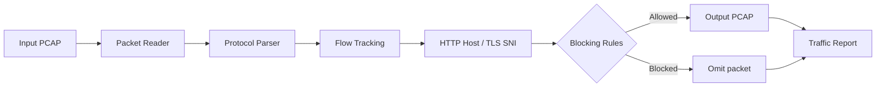

<div align="center">

# 🔎 DPI Engine

### A lightweight C++ Deep Packet Inspection engine for PCAP traffic

[](https://en.cppreference.com/w/cpp/17)
[](LICENSE)
[](#-getting-started)

**Parse packets · Classify traffic · Apply blocking rules · Export filtered PCAPs**

</div>

---

## ✨ Features

- 📦 Read and write **PCAP** files
- 🧩 Parse Ethernet, IPv4, TCP, and UDP headers
- 🔍 Identify traffic using HTTP `Host` and TLS SNI when available
- 🚦 Apply blocking rules by source IP, application, or domain
- ⚡ Single-threaded and multi-threaded processing
- 📊 Generate packet, protocol, and application statistics

## 🧭 How it works



## 🛠️ Tech stack

`C++17` · `PCAP` · `TCP/IP` · `TLS SNI` · `Multithreading`

## 🚀 Getting started

**Requirements:** Linux or macOS, plus `g++` or `clang++` with C++17 support.

Build the multi-threaded version from the project root:

```bash
g++ -std=c++17 -pthread -O2 -I include -o dpi_engine \
  src/dpi_mt.cpp \
  src/pcap_reader.cpp \
  src/packet_parser.cpp \
  src/sni_extractor.cpp \
  src/types.cpp
```

Run it on a capture file:

```bash
./dpi_engine test_dpi.pcap output.pcap
```

Example blocking rules:

```bash
./dpi_engine test_dpi.pcap output.pcap \
  --block-app YouTube \
  --block-ip 192.168.1.50 \
  --block-domain facebook
```

Generate sample traffic (if the script is included):

```bash
python3 generate_test_pcap.py
```

## 🧱 Processing pipeline

- **Reader** loads packets from the input capture.
- **Load balancers** distribute packets using a flow hash.
- **Fast paths** parse, classify, track flows, and evaluate rules.
- **Writer** saves allowed packets to the output capture.

For a simpler learning path, start with `src/main_working.cpp`.

## ⚠️ Notes

- This tool processes **PCAP files**; it is not a live network firewall by itself.
- Domain identification depends on available HTTP host data or TLS SNI. ECH, incomplete captures, and unsupported traffic may limit detection.
- Inspect only network traffic you are authorized to analyze.

## 📄 License

Released under the **MIT License**. See [`LICENSE`](LICENSE).
